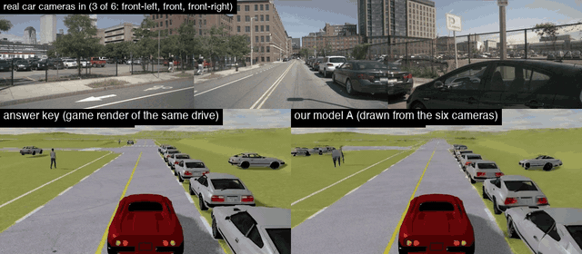
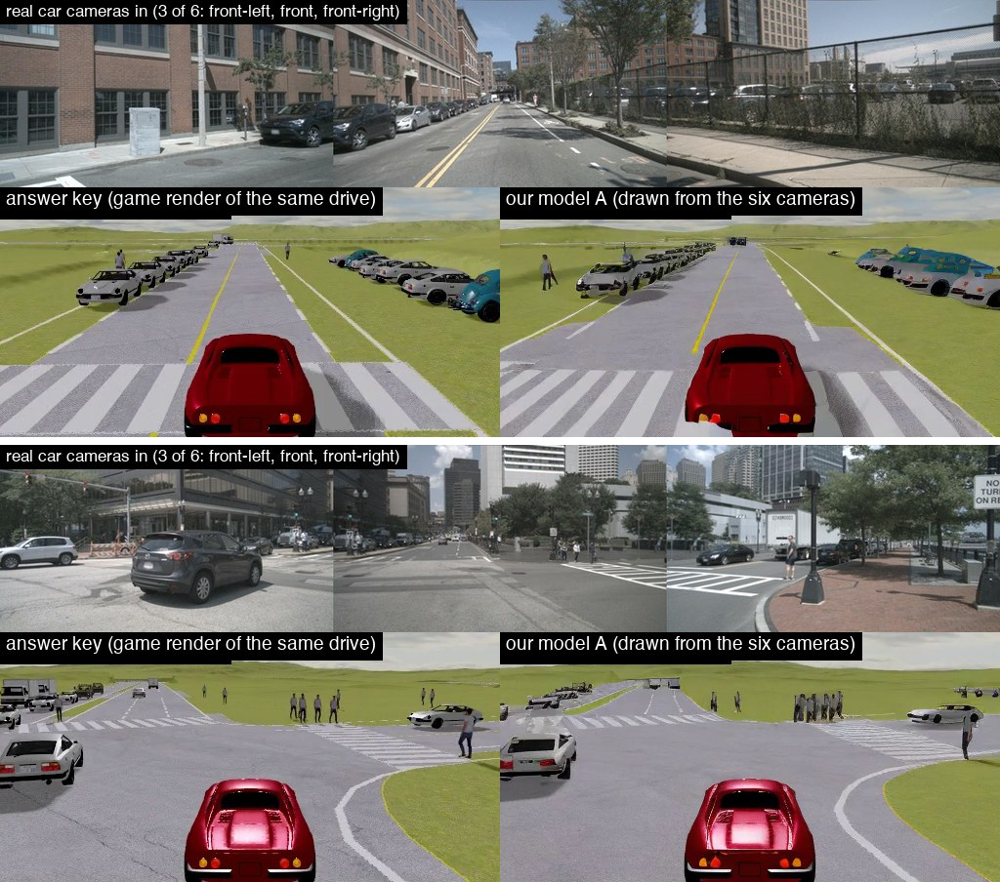

# Mini Reality View

**Follow it live: https://taruntomar122.github.io/mini-reality-view/**

A home-made, open version of Tesla's FSD v15 "Reality View": six ordinary car cameras go in, and a picture of the car
and its surroundings, seen from a camera floating behind it, comes out. Drawn by a diffusion model, not a game engine.



*Real cameras in (top). Bottom: the answer key, a game render of the same drive (left), and our best model so far, "A",
drawing from the six cameras (right), on a drive it never saw in training. 8 seconds at 10 frames a second. A draws
every frame on its own, with no memory, so cars can shift a little between frames. [Full MP4, two drives](docs/media/unseen_drives_A.mp4)*

## Where we are

| | Stage | Status |
|---|---|---|
| 1 | Make answer keys from real data (lidar points, then 3D reconstructions) and train a small renderer | done |
| 2 | Start from Stable Diffusion instead: photo-like pictures, cars roughly in place | done |
| 3 | Practise in a driving simulator first | done: a head start, not a better model |
| 4 | Real photos in, clean game-style chase view out (single-frame model "A") | **done: our best model** |
| 5 | Smooth video with a one-frame memory on top of A | closed: smoother, but drift and car mistakes grew |
| 6 | Live video by bolting small time layers onto the frozen image model | closed: see below |
| 7 | **Switch to a real pretrained video model (Wan 2.1, 1.3B), made live and camera-conditioned** | **plan signed, first checks running** |

**Now (28 Nov):** we stopped trying to turn an image model into a video model, and the plan for the replacement is
signed ([PLAN-video](council/PLAN-video.md)). Two overnight runs had added time layers to the frozen model A: with
shared noise it got 58% jumpier than A; with private noise it got smoother (15% fewer car jumps, 7% less wobble) but
placed cars worse and left fake cars lingering, so the agreed safety rule stopped it. Those layers only compare the same
pixel across frames, while everything in a driving view moves, and they had to learn motion from about 4 hours of
driving.

The new base is **Wan 2.1 (1.3B)**, an open video model (Apache-2.0) that has already learned motion from millions of
videos, and the model most open live-streaming work is built on. The plan:

- **First checks (running):** does Wan's picture compressor keep our cars intact, and how fast does it run on our GPUs.
- **S1:** teach it our task on whole 1.7-second clips, with small add-on layers (the base stays frozen).
- **S2:** make it causal (it only sees the past) and fast (4 steps), trained on its own earlier frames.
- **S3:** 2 steps, a tiny decoder, and live timing.

It has to beat A on the same signed checks: car accuracy at least as good as A's, and more than 9.4% smoother. It draws
frames in groups of four, so the live view runs at 10 frames a second about half a second behind; the owner accepted
that delay. A stays as the single-frame reference.

## The problem

A car's cameras sit 1.5 m off the ground and look outwards. Nobody films the car from behind and above, so there is no
"correct" picture to learn from. We have to make the answer key ourselves, and the model can only be as good as it.
Our fix: replay each real drive in a driving game (MetaDrive) and film it from a chase camera 7.5 m behind the car. The
inputs stay real photos; only the answer key is a game picture, which is clean and exact.

## The idea

What works today (model A, one frame at a time):

```
6 car photos ─► DINOv2 (frozen) ─► camera tokens + viewing rays ─► Stable Diffusion 1.5 + adapter ─► chase view
```

Tesla feeds its driving model's vision features to a ~1B diffusion model. We copy the shape at small scale: frozen
DINOv2 features from each camera replace Stable Diffusion's text prompt, and small trained layers teach it the task.

What we are building now (a video model that remembers and runs live):

```
6 car photos ─► depth estimate ─► photos painted into the chase camera ──┐
             └► raw camera tokens + viewing rays ──────────────────────┴► Wan 2.1 1.3B (frozen + small layers)
                                                                             ─► chase view, streamed 4 frames at a time
```

Geometry first: a small depth model (Depth Anything V2-Small) guesses how far away each pixel is, so the six photos can
be painted straight into the chase camera's view as a rough guide. The raw camera tokens are a second path for what the
guide misses. Wan then turns this into smooth video.

## What we got so far



*Two drives it never saw in training. A gets the road, kerbs, crossings and the rows of parked cars mostly right, and
draws the people too, though not always in the right spot (bottom: the key has a spread-out group; A bunches them up).*

- **It reads the cameras.** On unseen drives, A draws the right road shape, crossings and parked rows, mostly in the
  right places (car score 0.446 against the answer key on our 6 check drives). In an early check, given another
  drive's cameras, its car score collapsed (0.28 to 0.02), so it is not just guessing a typical street.
- **Clean answer keys fixed the mess.** Real photos in, game picture out: no more smears copied from
  rough 3D reconstructions.
- **Starting from Stable Diffusion** gave photo-quality drawing from day one instead of blobs.
- **But it is not video yet.** A draws each frame on its own, so cars shift a little from frame to frame, and one
  frame takes about 3.4 s on our 2080 Ti GPUs. That is why we are moving to a video model.

## What we learned

- **The answer key is everything.** Every flaw in it (gaps, smears, black holes) shows up in the output; switching to
  clean game keys fixed that.
- **Pixel scores reward blur.** LPIPS and a car-placement judge track what you see; plain pixel error does not.
- **A video model must train on its own frames,** or small errors pile up over a drive.
- **Memory can buy smoothness by holding on to the past.** Both memory designs got smoother partly by keeping old
  cars around too long and placing cars worse. Our checks now count lingering fake cars and drift, not just jumpiness.
- **An image model is a poor start for video.** Bolted-on time layers have to learn motion from scratch from 4 hours
  of driving; a pretrained video model already knows how things move.
- **A driving game gives a head start, not a better model** (at equal training, real data caught up).

Details, numbers and pictures for all of this: [the full write-up](docs/results.md) and [lab notes](PROGRESS.md).

## What did not work

- Training on rough 3D-reconstruction answer keys (blur scored well, looked worse).
- Mixing game pictures into every training batch (almost no cars drawn).
- Distilling to one step too early (smoother but worse).
- A one-frame memory on top of A (smoother, but drift and car mistakes grew with training).
- Small time layers on the frozen A, with shared or private noise (jumpier, or smoother with worse cars and lingering
  fakes).

## Honest limits

- The answer key is a game replay of the real drive, not the real world: the game's cars and people stand in for the
  real ones, so scores measure agreement with that replay.
- nuScenes hand labels come only twice a second. Our cameras and game keys run at 10 frames a second, so positions
  between labels are filled in and can be slightly off.
- Small scale: about 4 hours of driving and models far smaller than Tesla's. A is not live; the video model is not
  trained yet.

## Follow along

- **[Live page](https://taruntomar122.github.io/mini-reality-view/):** status, latest checks and videos.
- **[docs/results.md](docs/results.md):** the full write-up, section by section.
- **[PROGRESS.md](PROGRESS.md):** lab notes, newest first: every run, number and decision.
- **[council/](council/):** the research plans behind each experiment (current: [PLAN-video](council/PLAN-video.md)).
- **[docs/explainer.html](docs/explainer.html):** what goes in and comes out at each stage (open in a browser).

## Code

`mrv/` models and geometry · `scripts/` data, training (`train_sd.py`), rendering, judging, simulator
(`sim_render.py`) · `slurm/` cluster jobs · `scripts/try_my_photos.py` six photos in, one picture out.

nuScenes is free for non-commercial use; this is a non-commercial learning project.
