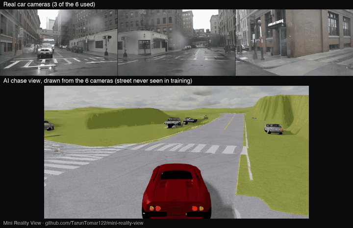
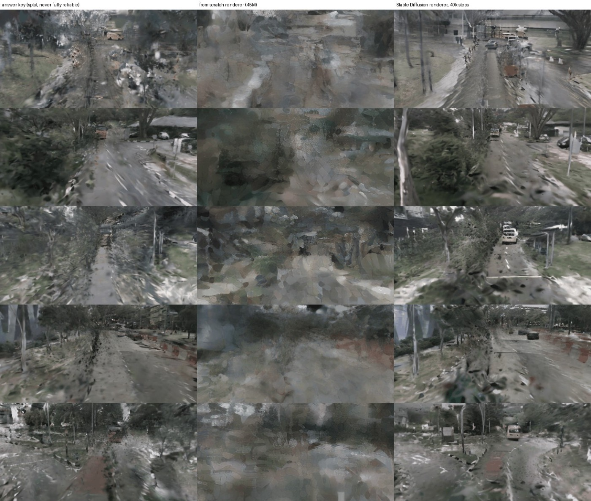

# Mini Reality View

**Follow it live: https://taruntomar122.github.io/mini-reality-view/**

A home-made, open version of Tesla's FSD v15 "Reality View": six ordinary car cameras go in, and a picture of the car
and its surroundings, seen from a camera floating behind it, comes out. Drawn by a diffusion model, not a game engine.



*Real cameras in (top), our model's chase view out (bottom), on a street it never saw in training. Early checkpoint
(2,500 of 10,000 steps); every frame is drawn on its own, with no memory yet. [MP4](docs/media/busy_junction.mp4)*

## Where we are

| | Stage | Status |
|---|---|---|
| 1 | Make answer keys from real data (lidar points, then 3D reconstructions) and train a small renderer | done |
| 2 | Start from Stable Diffusion instead: photo-like pictures, cars roughly in place | done |
| 3 | Practise in a driving simulator first | done: a head start, not a better model |
| 4 | **Real photos in, clean game-style third-person view out** | **running now** |
| 5 | Phone photos, speed (1–4 steps), video, final write-up | next |

**Now:** our answer keys were always messy (smears, holes), and the model copied the mess. So we switched the target:
the same real camera photos go in, but the answer is a game render of the exact same moment, where every car and
person sits where it really was. Three experiments are running to pick the starting model and check whether ~7,900
pairs are enough ([plan](council/PLAN-tpv.md)).

## The problem

A car's cameras sit 1.5 m off the ground and look outwards. Nobody films the car from behind and above, so there is no
"correct" picture to learn from. We have to make the answer key ourselves, and the model can only be as good as it.

## The idea

```
6 car photos ─► DINOv2 (frozen) ─► camera tokens + viewing rays ─► Stable Diffusion 1.5 + adapter ─► view from behind
```

Tesla feeds its driving model's vision features to a ~1B diffusion model. We copy the shape at small scale: frozen
DINOv2 features from each camera replace Stable Diffusion's text prompt, and small trained layers teach it the task.

## What we got so far

- **It reads the cameras.** On streets it has never seen, it draws the right road, kerbs, trees, parked cars and
  barriers, mostly in the right places. Given the wrong cameras, its car score drops from 0.29 to 0.03.
- **Starting from Stable Diffusion was the biggest win:** photo-like streets instead of smeary blobs.
- **But it is still messy and imprecise.** It copies the flaws of its answer keys, and car placement stopped
  improving after about 20,000 training steps.



## What we learned

- **The answer key is everything.** Every flaw in it (gaps, smears, black holes) shows up in the output.
- **Pixel scores reward blur.** LPIPS and a placement judge track what you see; plain pixel error does not.
- **A video model must train on its own frames,** or small errors pile up over a scene.
- **A driving game gives a head start, not a better model** (at equal training, real data caught up).

Details, numbers and pictures for all of this: [the full write-up](docs/results.md).

## What did not work

- Mixing game pictures into every training batch (almost no cars drawn).
- Distilling to one step too early (smoother but worse).
- Training on rough reconstruction keys (blur scored well, looked worse).

## Honest limits

- Our answer keys are not ground truth, so scores measure agreement with a key, not with reality.
- nuScenes labels come at 2 Hz, so our "video" is 2 frames per second.
- Small scale: about 4 hours of driving and a model far smaller than Tesla's.

## Follow along

- **[docs/results.md](docs/results.md):** the full write-up, section by section.
- **[PROGRESS.md](PROGRESS.md):** lab notes, newest first: every run, number and decision.
- **[council/](council/):** the research plans behind each experiment.
- **[docs/explainer.html](docs/explainer.html):** what goes in and comes out at each stage (open in a browser).

## Code

`mrv/` models and geometry · `scripts/` data, training (`train_sd.py`), rendering, judging, simulator
(`sim_render.py`) · `slurm/` cluster jobs · `scripts/try_my_photos.py` six photos in, one picture out.

nuScenes is free for non-commercial use; this is a non-commercial learning project.
