# Mini Reality View: a drone's-eye view of the car, drawn by a diffusion model from its six cameras

We are rebuilding, at home and in the open, the idea behind Tesla's FSD v15 "Reality View": a live picture of the car
and its surroundings seen from a virtual camera floating behind and above it. Six ordinary car cameras go in; a small
image generator draws the chase view. No game engine, no 3D car models.

**Status: work in progress.** This page is updated as results come in. Lab notes with every number and job: `PROGRESS.md`.

## The problem

A car's cameras sit about 1.5 m off the ground and look outwards. Nobody films the car from 8 m above and behind, so
there is no "correct" drone picture to learn from. To train a model to draw that view, we first have to make the
answer key ourselves, and the model can only ever be as good as that key.

## The idea

Tesla's description (Elon Musk on X, 22 Nov 2026): the same vision features that drive the car are fed to a separate
~1B-parameter diffusion model, which takes the previous Reality View frame plus a little noise and denoises it into
the next one. We copy that shape at a small scale:

```
6 car photos ─► DINOv2 (frozen) ─► camera tokens ─┐
                                                   ├─► diffusion renderer ─► drone-view frame
previous frame + a little noise ───────────────────┘          │
                         ▲                                     │
                         └─────────── fed back ────────────────┘
```

- **Camera tokens:** each photo goes through a frozen DINOv2-small; every 14×14 patch becomes a list of 384 numbers.
- **Renderer:** a diffusion transformer (DiT) trained with flow matching, working in Stable Diffusion's compressed
  image space (a 256×144 frame becomes 4×18×32 numbers).
- **Video:** the previous output, with noise added, is a second input, so frames stay consistent and small mistakes
  don't snowball.

[`docs/explainer.html`](docs/explainer.html) walks through every stage with pictures (open it in a browser).

## Making the answer key

We tried three kinds of key, each better than the last.

**1. Lidar points, one moment.** Colour each lidar point with the camera pixel it lands on, then look at the coloured
points from the virtual drone (13 m behind, 8.5 m up). About 40% of the picture gets covered; the rest is holes.

**2. Lidar points, whole scene.** Things that don't move are the same in every frame, so we merge lidar from the whole
20-second scene for them, and use only the current frame for cars and people (from nuScenes' 3D boxes). Coverage goes
up to 50–80% of the picture.

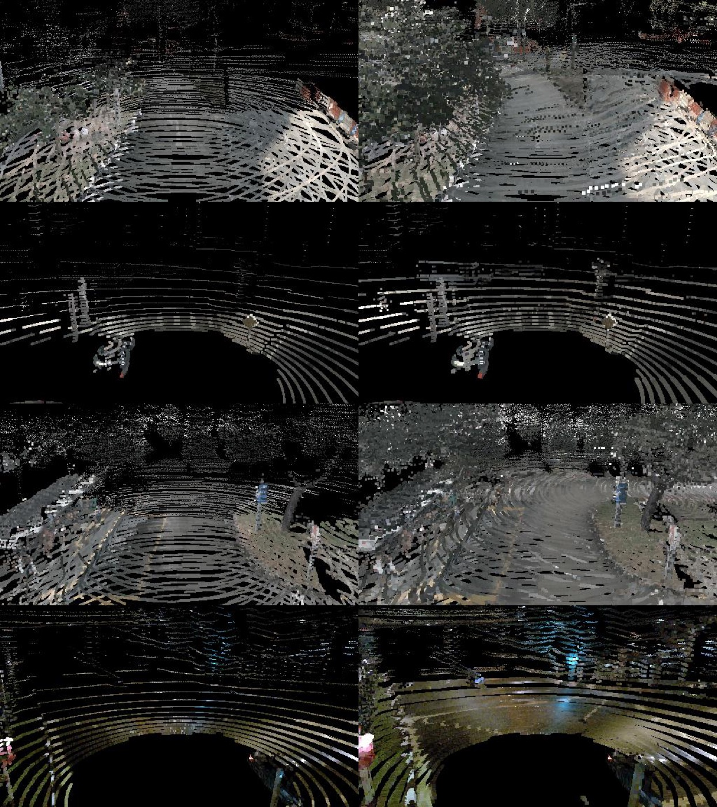

**3. Gaussian splats.** Rebuild each scene as a 3D Gaussian-splat model (Street Gaussians in
[drivestudio](https://github.com/ziyc/drivestudio)), fitted to all six cameras, then render it from the drone camera.
The keys become complete pictures: parked cars, an excavator, lane paint and shop fronts that the lidar keys miss.
They cost about 1.5–2 GPU-hours per scene, so we can only afford them for some scenes.

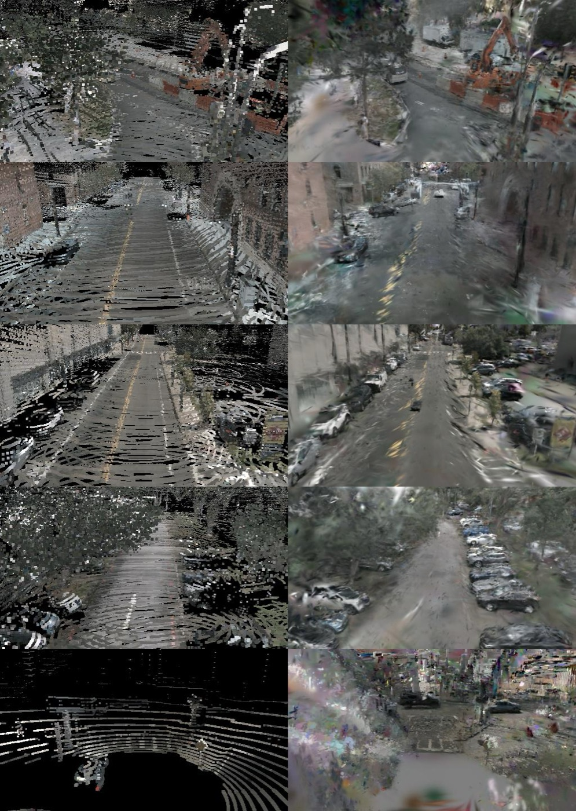

**Lower drone, cleaner splats.** The real cameras are 1.5 m up, so from 8.5 m the splat scene shows coloured floaters
and smears where no camera ever looked. Moving the drone to 9 m behind and 4.5 m up, and re-rendering the same splat
models (no retraining), removes most of them: parked cars, facades and the excavator come out sharper, and the sky
appears. Some smearing stays at the bottom corners, right behind the car, which no camera sees.

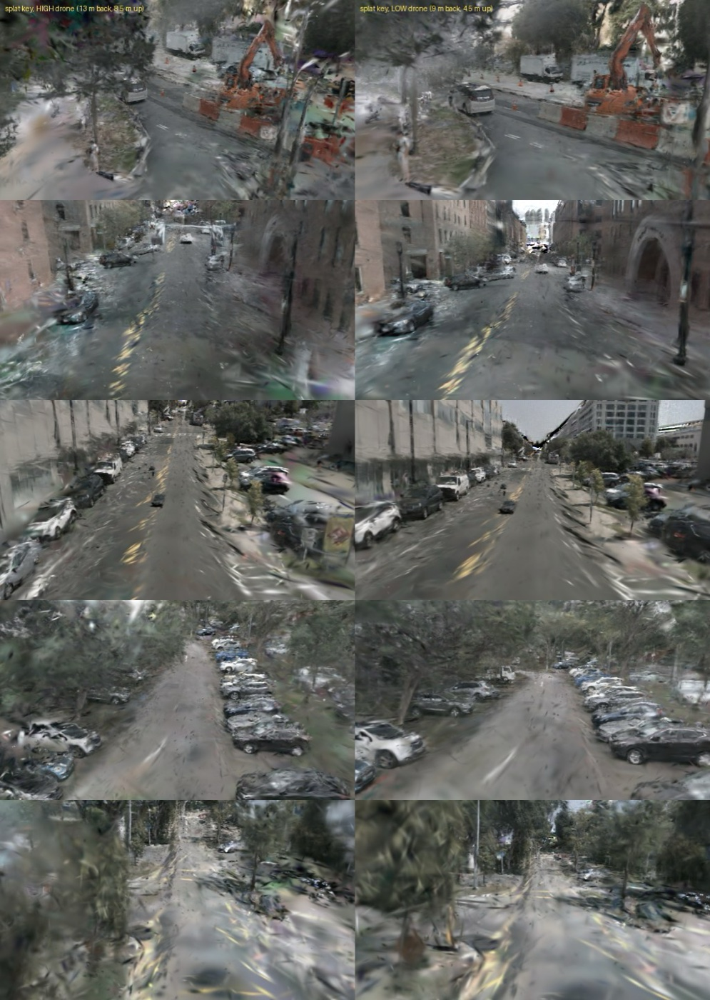

## What we got so far

Data: nuScenes (850 driving scenes of 20 s, Boston and Singapore, 6 cameras, keyframes at 2 Hz). Every number below is
on the official **val** scenes, which the models never saw. Masked L1 is the average pixel error (0–255) where the key
has data; LPIPS measures how different two pictures look to a neural network (lower is better). The "mean image"
baseline is the average answer key: what you score if you ignore the cameras completely.

| Model | Training scenes | Size | Masked L1 | LPIPS |
|---|---|---|---|---|
| Mean image (ignores the cameras) | – | – | 30.6 | 0.655 |
| Small renderer | 290 | 45M | 28.1 | 0.412 |
| **Bigger renderer** | 700 | 110M | **27.8** | **0.374** |

*30 val scenes, 4 sampling steps, lidar keys.*

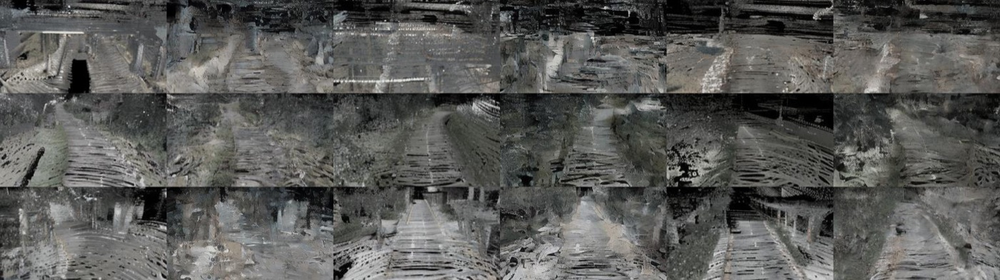

- **It reads the cameras.** On streets it has never seen, the model draws the right kind of road: curves where the road
  curves, kerbs, trees and buildings roughly where they are. LPIPS drops from 0.66 (ignoring the cameras) to 0.37.
- **It is blurry and copies the key's flaws.** It draws the lidar's ring-shaped stripes and holes, because that is what
  the key looks like. That is the main reason for the splat keys and the plan below.
- **One step is nearly enough.** The bigger renderer scores LPIPS 0.374 with 4 denoising steps, 0.383 with 2 and 0.381
  with 1. A small model at 2 steps runs at about 20 frames per second on one seventh of an H200 (including turning the
  result back into pixels).

**Telling the model where each camera points helps a little.** Each camera token also gets the direction of its
viewing ray (from the camera's calibration), so the model doesn't have to work out the camera layout itself.
Same 45M model, same 700 scenes: LPIPS 0.384 without rays, 0.377 with. Road edges and kerbs land slightly more often
in the right place.

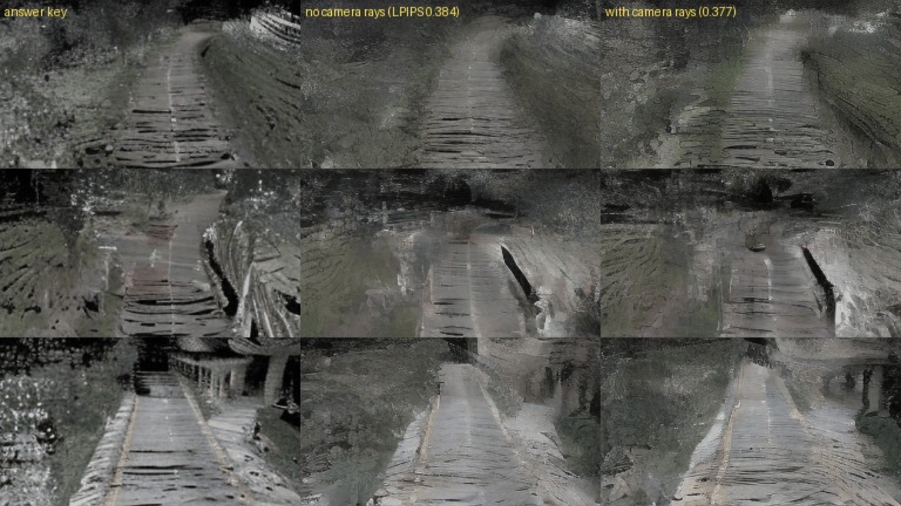

**Video drifts unless the previous frame is noisy enough.** The video model gets its own previous frame back as an
input. With a little noise on it (0.1), errors pile up over a 20-second scene: pixel error 27.4 in the first frames,
35.2 in the last, and some scenes wash out to grey. With more noise (0.3) the model trusts its past less, quality
matches the single-frame model (LPIPS 0.374) and the end-of-scene error drops to 30.8. Noise 0.5 is worse again
(0.408), more than the model saw in training.

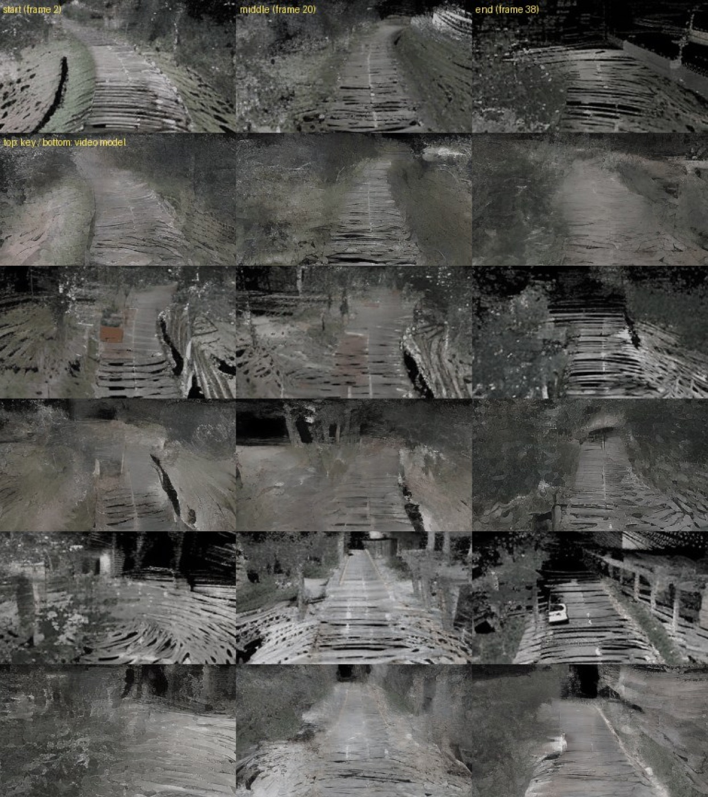

**Training on its own mistakes fixes most of the rest.** The drift comes from a mismatch: in training the previous frame
is always a perfect answer key, at run time it is the model's own imperfect picture. We fine-tuned the video model so
that half the time its "previous frame" is one it drew itself. Over a whole scene it now scores LPIPS 0.368 (our best
so far, better than the single-frame model's 0.374), and pixel error rises only 1.8 from start to end (was 7.8).
The last frames keep their road texture instead of fading to grey.

| Video model, whole 20 s scenes | LPIPS | Pixel error, first 5 → last 5 frames |
|---|---|---|
| Previous frame with noise 0.1 | 0.389 | 27.4 → 35.2 |
| Noise 0.3 | 0.374 | 27.4 → 30.8 |
| **Noise 0.3, trained on its own frames** | **0.368** | 28.5 → 30.3 |

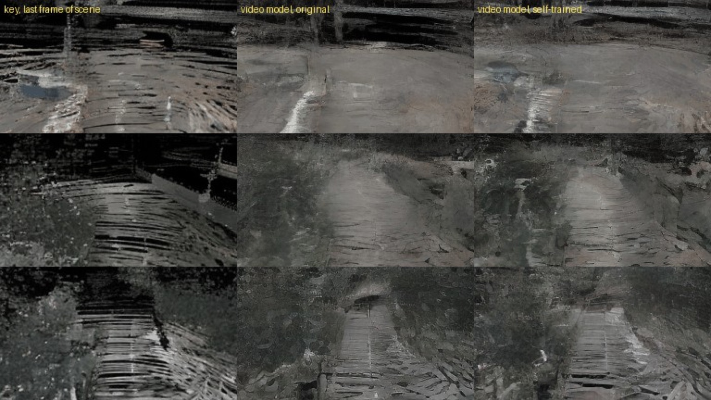

**Starting from Stable Diffusion changes the look completely (early result).** We kept Stable Diffusion 1.5 frozen
and taught it our task with a small camera adapter (the camera tokens and rays replace its text prompt) and LoRA
layers. After only 5,000 of 40,000 training steps it draws photo-like streets with tree trunks, kerbs, lane lines,
poles and trucks, roughly where the answer key has them (for example a truck ahead on a tree-lined road). On 4 unseen
scenes: pixel error 33.5, LPIPS 0.390, already ahead of our from-scratch model on the same kind of key (34.1 / 0.405).
Exact positions are not precise yet. Training continues.

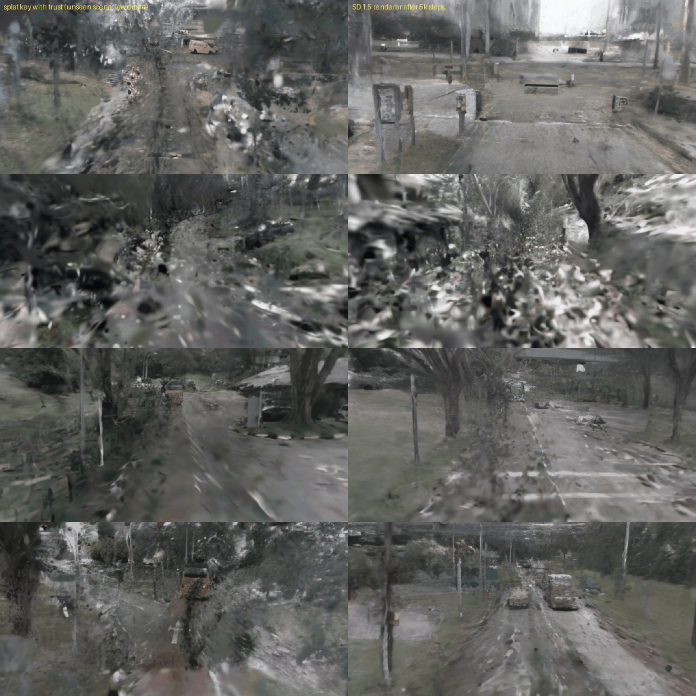

## What we learned

- **Data matters most at first.** Trained on 8 scenes, the model memorises them perfectly (pixel error 3) and draws a
  grey blur on anything new (error 20–56). With 290 and then 700 scenes it starts drawing real streets.
- **The pixel score hides progress.** Blur scores well on L1, so the bigger model's L1 barely moves (28.1 → 27.8)
  while its pictures are visibly sharper; LPIPS (0.41 → 0.37) tracks what you see.
- **Splat keys break when the camera is too high.** The real cameras are 1.5 m up; at 8.5 m the splat scene shows
  floaters and smears where no camera ever looked.

- **Trust masks help where the key is good, but the model then copies the key's holes.** We weighted the loss by how
  much each pixel of the splat key can be trusted (seen by a real camera, depth agrees with lidar). On 12 unseen scenes,
  scored only on trusted pixels, LPIPS improves from 0.399 to 0.364 and pixel error stays the same (27.2 vs 27.8).
  But the ground right under and behind our car was never seen by any camera, so the key is black there, and the
  trust-weighted model learns to draw that black hole too (right column). The unweighted model fills it with mush.
  A fix would be zero weight there plus a pretrained model that can fill the gap, which is what the Stable Diffusion
  renderer is for.

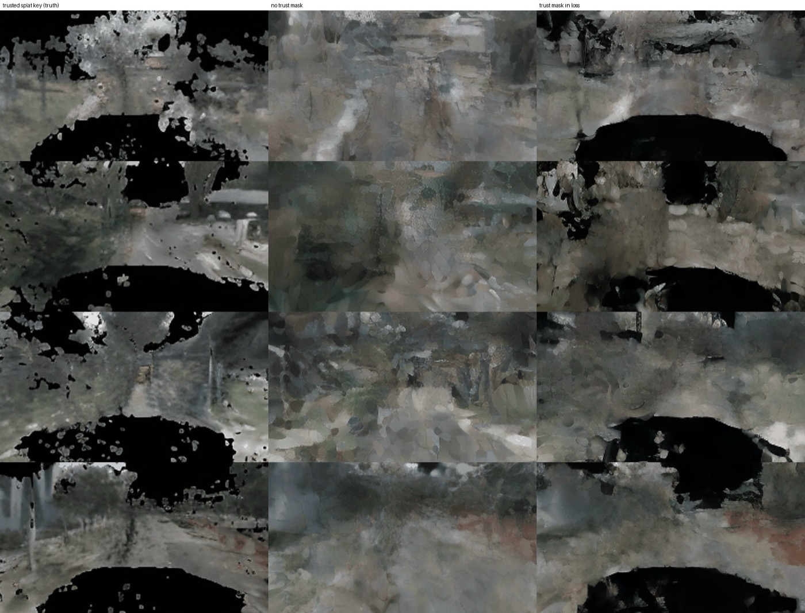

## What did not work

- **Distilling to one step.** We trained a one-step copy of the bigger renderer to reproduce its 4-step pictures from
  the same noise. Its pixel error is lower (27.4 vs 28.9 for the plain model at one step), but it looks slightly
  smoother and scores worse on LPIPS (0.394 vs 0.381). The plain model already takes almost straight paths from noise
  to picture, so there was little left to gain.

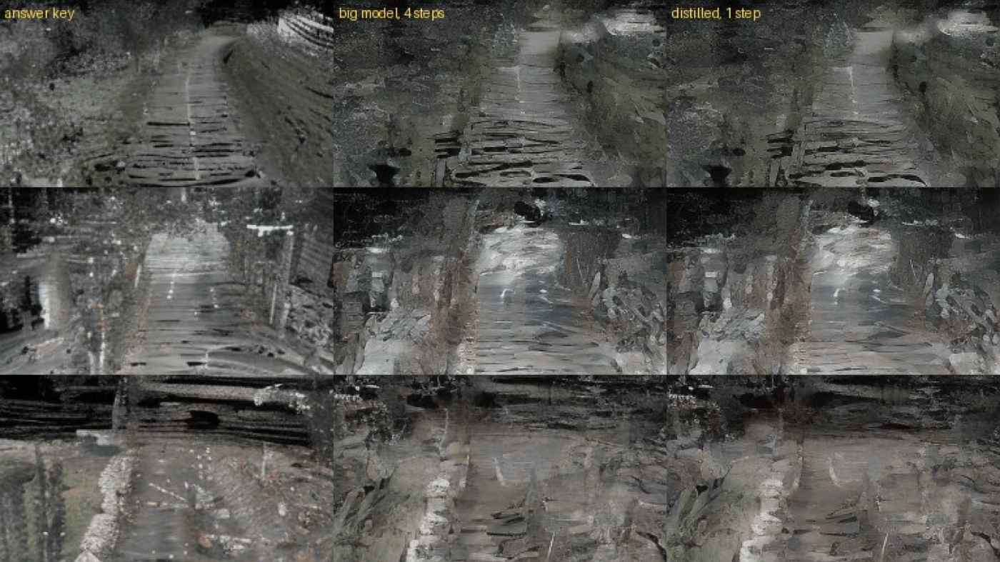

- **Mixing in rough splat keys.** We fine-tuned the bigger renderer on lidar keys and splat keys together, with a tag
  saying which style to draw. Asked for "splat style" on unseen scenes, its pixel error against the splat keys
  dropped from 37.5 to 28.9, but the pictures got worse: soft mush instead of a road. Those splat keys were rendered
  from the high drone after a short fit and are full of smears, and against a noisy key blur is the safest answer.
  The pixel score rewarded it. We now use the lower drone and trust masks for splat keys instead.

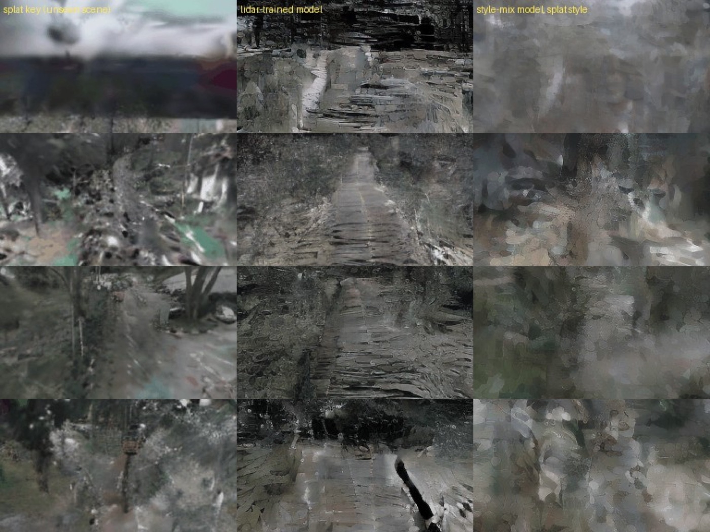

## Problems we hit (and fixed)

- **Parked car, night scene, crash at step 0.** With the car standing still, the lidar contains exact duplicate
  points, so the starting size of some splats was log(0). A new seed and switching off the regulariser didn't help;
  clamping the starting distance to 0.1 mm did.
- **Splat preprocessing thrashed.** Eight workers, each holding all of nuScenes' metadata, hit the memory limit and
  did 6 scenes in 2 hours. One small job per scene fixed it.

## Honest limits

- **The answer keys are not ground truth.** They are lidar points or 3D reconstructions, each with their own errors.
  Our scores say how close the model gets to the key, not to reality.
- **2 Hz.** nuScenes labels and lidar keyframes come at 2 Hz, so our "video" is 2 frames per second for now.
- **Small and slow compared to Tesla.** Our renderer is 45–110M parameters (Tesla's is about 1B, plus a 3B driving
  model), and our training data is about 4 hours of driving (700 scenes of 20 s).
- **Speed numbers are on a data-centre GPU**, not a car computer.

## What's next

1. ~~Lower drone camera~~ and ~~trust masks~~: done (see above).
2. **Simulator pretraining:** replay nuScenes drives in a driving simulator, where the drone-view answer is exact, and test whether that helps the real model place cars and kerbs (running).
3. **Camera geometry as input:** give each camera token its viewing ray, so the model doesn't have to guess where each
   camera points.
4. **Start from a pretrained image model** (Stable Diffusion 1.5 with LoRA and a camera-token adapter; Difix to clean
   splat keys) so the model already knows what streets look like. (Running.)
5. **Try it on your own photos:** six phone photos taken in a street, no calibration needed. Training adds random
   crops, zoom, colour and small turns so phone pictures look familiar to the model.
6. **Distil to 1–4 steps**, then a final evaluation and video results.

## For researchers

- Data: nuScenes v1.0-trainval (700 train / 150 val, official split) and v1.0-mini, from the public AWS mirror.
- Inputs: 6 × 448×252 photos → DINOv2-small (frozen), patch tokens 2×2 average-pooled to 6 × 144 × 384.
- Keys: 512×288 RGBA (alpha = covered), chase camera 13 m behind / 8.5 m above the ego origin looking at a point 12 m
  ahead on the ground, 60° horizontal FOV. Lidar keys: static points from all keyframes of the scene, dynamic points
  (inside nuScenes boxes of movable classes, 15% margin) from the current keyframe only, coloured by the first camera
  that sees them, 0.12 m squares. Splat keys: drivestudio `streetgs.yaml`, 6 cameras, 10 Hz, 30k iterations (15k for
  trainval), no SMPL.
- Latents: SD VAE (`sd-vae-ft-mse`) at 256×144 → 4×18×32, scaled by 0.18215 and normalised by their std.
- Renderer: DiT with adaLN-Zero, patch 2, cross-attention to the camera tokens (+ learned per-camera embedding and
  2D sin-cos positions); 45M (384×12) and 110M (512×16). Flow matching (x_t = (1−t)·x + t·ε, predict ε − x,
  logit-normal t), AdamW 2e-4, batch 64, EMA 0.999, loss weighted by key coverage (0.05 where the key is empty).
  Video variant: previous latent with noise s ~ U(0, 0.3) concatenated on channels, pure noise 10% of the time.
- Evaluation: Euler sampling, masked L1 on decoded 256×144 frames, LPIPS (AlexNet) on coverage-masked frames.

## Code

`mrv/nusc.py` (poses, point colouring, chase cameras, point splatting) · `mrv/model.py` (renderer) ·
`scripts/make_targets.py` (lidar keys) · `scripts/encode.py` (DINOv2 tokens + VAE latents) · `scripts/train.py`
(training, video, style-mixed training) · `scripts/evaluate.py` (held-out evaluation) · `scripts/steps_speed.py`,
`scripts/distill.py` (speed) · `scripts/ds_render_chase.py`, `scripts/sky_masks.py` + `slurm/ds_*.sh` (splat keys with
drivestudio) · `slurm/` (cluster jobs). Lab notes: `PROGRESS.md`.

nuScenes is free for non-commercial use; this project is a non-commercial learning project.
